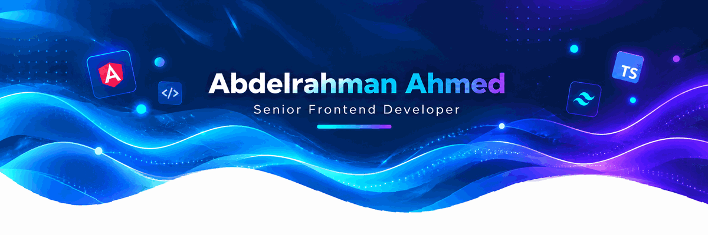

  

# 👋 Hi, I'm Abdelrahman Ahmed

### Front-End Developer | Angular & React Specialist

I'm a dedicated **Front-End Developer with 5+ years of experience** building modern, scalable, and interactive web applications.

I specialize in **Angular and React**, with a strong focus on clean architecture, reusable components, responsive UI, performance optimization, and great user experiences.

---

## 🚀 About Me

- 💻 **5+ years** of professional Front-End Development experience
- ⚡ Specialized in **Angular & React**
- 🧩 Experienced in building **scalable and reusable UI components**
- 🔌 Experienced in integrating and working with **RESTful APIs**
- 📈 Focused on **performance optimization** and improving user experience
- 🤝 Comfortable working in collaborative **Agile/Scrum teams**
- 🌱 Always learning and keeping up with modern Front-End technologies
- 🎯 Passionate about writing clean, maintainable, and production-ready code

---

## 🛠️ Tech Stack

### Front-End

  

  
  

### UI & Styling

  

### Tools & Workflow

  

  

  

---

## 💡 Core Skills

  

  

  

  
  
  
  
  

---

## 📌 What I Do

<h2 align="center">🚀 Front-End Development</h2>

<table align="center">
  <thead>
    <tr>
      <th align="left">Technology</th>
      <th align="left">Expertise</th>
      <th align="left">Focus</th>
    </tr>
  </thead>
  <tbody>
    <tr>
      <td>🅰️ Angular / ⚛️ React</td>
      <td>Modern Web Apps</td>
      <td>Reusable Components & Architecture</td>
    </tr>
    <tr>
      <td>🔷 TypeScript</td>
      <td>Scalable Code</td>
      <td>Type Safety & Maintainability</td>
    </tr>
    <tr>
      <td>🔄 RxJS</td>
      <td>Reactive Systems</td>
      <td>Async Data & Streams</td>
    </tr>
    <tr>
      <td>🌐 REST APIs</td>
      <td>Data Integration</td>
      <td>HTTP Services & API Handling</td>
    </tr>
    <tr>
      <td>🎨 SCSS / Tailwind CSS</td>
      <td>Modern UI</td>
      <td>Responsive & Consistent Design</td>
    </tr>
    <tr>
      <td>🧩 Angular Material / PrimeNG</td>
      <td>UI Component Libraries</td>
      <td>Accessible & Reusable Components</td>
    </tr>
    <tr>
      <td>🌿 Git / GitHub</td>
      <td>Team Collaboration</td>
      <td>Version Control & Code Reviews</td>
    </tr>
    <tr>
      <td>⚡ Performance Optimization</td>
      <td>Fast User Experience</td>
      <td>Loading Speed & Rendering</td>
    </tr>
  </tbody>
</table>

## 🐍 GitHub Contribution Snake

  

